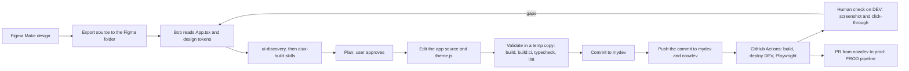

# Lighthouse: from a Figma export to a deployed AIUX portal page

This document records how the Claude Learning Portal went from a Figma Make design to a ServiceNow AIUX (Lux) app running on a DEV instance, built with Bob and deployed by GitHub Actions. It is meant as a repeatable reference for the next app.

Everything below comes from this repository's files and git history. Where something was not seen working, it says so.

- Repository: claudelearningportal, owned by the GitHub user anilvaranasi
- App scope: x_ibmin_claudel (name ClaudeLearningPortal, URL basename claudelearningportal)
- Stack: ServiceNow Fluent SDK + AIUX (Lit web components), Tailwind + DaisyUI, pnpm, Playwright, GitHub Actions

---

## 1. The flow at a glance

The loop from the human check (K) back to Bob (C) ran several times. The design kept changing, so expect more alignment rounds.

---

## 2. Step 1: Figma design to a folder Bob can read

What was done

1. The design lives in Figma Make. Its URL could not be read through the Figma REST API, so the design was exported as source code instead.
2. The export sits in Figma/ServiceNow AI UX Claude Learning/ (a Vite + React + Tailwind project).
3. In that export, src/app/App.tsx is the only real design file. Header, QuickActions, RecentActivity, ServiceCard and StatsCard are unused template leftovers and were ignored.
4. The Figma/ folder is deliberately never committed (it is untracked in git). It is a reference, not part of the app.

What Bob took from the export (read from App.tsx)

| Design element | Value |
| --- | --- |
| Hero background | lilac #f8f4fb |
| Primary purple | #754b91 |
| Pink dot / accent | #e0529d |
| Search send button | near-black #1b1720 |
| Headings / body fonts | Roboto Slab / DM Sans |
| Layout | centered hero with a pill, headline "What would you like to try?", one search bar, example links, then a four-cell capability grid |

Tips for the next export

- Give Bob the folder path, and tell it which file is the real design.
- Re-export after each design change. Bob compares file timestamps and re-reads App.tsx.
- Say which parts are not to be built. Here: Recent experiments, the footer, "View all", "Open API console", the header bar with tabs, and the floating help button.

---

## 3. Step 2: Bob builds the AIUX page

Rules Bob follows (from AGENTS.md, which is the canonical guidance file for coding agents):

1. For any UI work, run the ui-discovery skill first, then aiux-build, then accessibility and i18n checks.
2. Present a plan and wait for approval before editing.
3. Code rules:
   - Components extend AIUXElement or AIUXWidgetElement, never LitElement.
   - Guard browser globals with isServer.
   - Tailwind + DaisyUI only. No hex colors in components; colors live in src/lux/theme.js.
   - No opacity-modified semantic colors such as bg-success/15. Use bg-base-200 and similar.
   - Every string goes through i18n.getMessage.
   - Icons go through icon() from @servicenow/aiux/aiux-directive-icon.
   - static styles is for :host only.

What exists in the app (src/lux/)

| Path | Purpose |
| --- | --- |
| theme.js | Palette: primary #754B91, accent #E0529D, neutral #FBF9FC |
| application.js | App shell using the shared aiux-nav-layout |
| pages/home/page.js | The Home page: lilac hero, search bar, capability grid, status section |
| widgets/otto-search/ | The search bar and answer dialog (tag aiux-otto-search). Calls Claude through a server script. User-facing text now says "Claude" |
| widgets/claude-status/ | Status panel with a "Test connection" button |
| src/fluent/index.now.ts | System properties: claude_api_key (no value in source), claude_base_url, claude_model, claude_max_tokens |

Design gaps accepted on purpose

- The send button stays purple. Making it near-black would need a dark neutral in theme.js and would affect the whole palette.
- Headings use a system serif, not Roboto Slab, and body text uses the platform font, not DM Sans. Web fonts mean an external request and possibly a CSP change.
- Some Figma wording was changed to match what the app really does (for example "from pasted text", because nothing uploads files).

---

## 4. Step 3: Claude API integration

- The Home page calls Claude through the IBM gateway at https://api.servicesessentials.ibm.com.
- Server scripts call POST <base>/v1/messages with headers x-api-key and anthropic-version: 2023-06-01. The model default is claude-sonnet-5-5.
- The key is stored in the private password2 property x_ibmin_claudel.claude_api_key. It has no value in source control. An admin sets it on each instance under System Properties. It never reaches the browser.
- Server scripts log HTTP status and Anthropic's error.type only, never response bodies. Timeout is 30 seconds. Search replies are capped at 1,024 tokens.

Seen working: a live answer in the dialog, "Ask this" loading a new answer with new follow-ups, and Close returning focus to the search box (confirmed on DEV by the user).

Not seen: narrow and mobile widths, error states (bad key, unreachable gateway), screen reader use, keyboard-only use of the dialog, the "Test connection" button result.

---

## 5. Step 4: Local validation (never in the OneDrive folder)

Bob does not run pnpm install or pnpm build in the OneDrive project folder. Instead it validates in a temp copy at %TEMP%\clp-validate:

1. Mirror src/ (and any changed root files such as aiux.json) into the temp copy.
2. Run, one log per step in %TEMP%\clp-validate-logs:
   - pnpm build
   - pnpm build:ci (uses --frozenKeys)
   - pnpm typecheck
   - pnpm lint
3. src/fluent/generated/keys.ts is generated. If the build changes it (for example deleted: true markers after removing a widget), copy it back and commit it. Keep LF line endings (.gitattributes sets eol=lf), or build:ci fails.

A change is ready when lint reports no warnings, not just no errors.

---

## 6. Step 5: Git and the DEV pipeline

### Branches

| Branch | Role |
| --- | --- |
| mydev | Where all commits go. Never commit to master |
| nowdev | Push here to deploy to DEV |
| prod | PR from nowdev; triggers the PROD pipeline |
| master | Default branch, effectively stale. Cleanup is still open |

### Deploy to DEV

Command: git push origin <sha>:refs/heads/mydev <sha>:refs/heads/nowdev

- The push is slow because of the VaultRadar hook, and the exit code is often 1 even on success. Run it in the background, then verify with git ls-remote --heads origin.
- Check the run: gh run list --repo anilvaranasi/claudelearningportal --branch nowdev --limit 1, then gh run view <id> --json status,conclusion,jobs.

### What nowdev-pipeline.yml does

Trigger: push to nowdev, or manual dispatch. concurrency.cancel-in-progress is false, so a newer push waits instead of killing a now-sdk install midway.

| Job | Environment | Steps |
| --- | --- | --- |
| build | none | Checkout, pnpm, Node from .nvmrc (24.14.1), pnpm install --frozen-lockfile, validate now.config.json (scope, scopeId, name), pnpm typecheck, pnpm lint, pnpm build:ci |
| deploy-dev | development | Same setup, build again (now-sdk install only zips an existing build and does not build), then pnpm run deploy with SN_SDK_* variables |
| playwright-dev | development | Install Chromium, pnpm test against DEV, upload playwright-report/ for 14 days |

Deploy authentication uses these environment variables, filled from secrets:

| Variable | Source secret |
| --- | --- |
| SN_SDK_NODE_ENV | fixed value SN_SDK_CI_INSTALL |
| SN_SDK_AUTH_TYPE | fixed value basic |
| SN_SDK_INSTANCE_URL | SN_DEV_INSTANCE |
| SN_SDK_USER | SN_DEV_USER |
| SN_SDK_USER_PWD | SN_DEV_PASS |

Secrets are stored per environment (development has SN_DEV_*, production has SN_PROD_*). There are no repo-level secrets. Never put secret values in files, chats or logs.

Use pnpm run deploy, not pnpm deploy: pnpm's built-in workspace command shadows the package script.

### Playwright: what it does and does not prove

tests/smoke.spec.ts has two tests: the instance is reachable and the session is authenticated, and /aiux/claudelearningportal/home returns a status below 400. A pass means the route loads. It does not prove the widgets render or that Claude is configured.

### The pull job (sn-pull-sync.yml)

A manual workflow meant to pull instance changes back into mydev using now-sdk transform.

- It ran with dry_run=true, and it needed a workaround: SDK 4.14.0 fails on now.config.json with "target node (Block) could not be parsed". .github/scripts/run-transform.sh tolerates only that exact error, marks the run partial, and the commit step refuses to commit a partial run.
- The diff artifact leaves out src/fluent and now.config.json because the repo is public.
- Its useful result so far: the source stored on DEV matched mydev apart from the workflow file. It is not a way to pull widget edits made on the instance.

---

## 7. The PROD pipeline (not used yet)

prod-pipeline.yml triggers on a PR or push to prod, or manual dispatch:

1. playwright-gate: runs Playwright against DEV.
2. build-prod: typecheck, lint, build:ci.
3. deploy-prod (push or dispatch only, environment production): build, install on PROD, then create a release-YYYYMMDD-HHMMSS tag.

Warnings

- The workflow's comment says the production environment needs a required reviewer, but the GitHub API shows no protection rules on either environment. A push to prod would deploy without a manual approval.
- The gate tests whatever is installed on DEV, which may not be the commit being promoted.
- PROD's company code is unchecked. PROD work is on hold.

---

## 8. Problems met and what fixed them

| Problem | Cause | Fix |
| --- | --- | --- |
| Reserved scope prefix | x_snc_ is reserved | Changed to x_146833_claudel, then x_ibmin_claudel for the new DEV instance |
| Deploy installed nothing useful | now-sdk install does not build | Added a build step before install in both deploy jobs |
| "Core scripts failed to load" | The AI Experience Framework plugins were not installed on DEV (see docs/troubleshooting-core-scripts-failed-to-load.md) | Documented the diagnosis |
| Stale cards and old button labels on DEV | Browser or instance cache, not a bad deploy | Clearing the cache fixed otto-search and the status card |
| build:ci failing after removing widgets | keys.ts is generated | Copy the build's keys.ts (with deleted: true markers) back and commit it |
| transform fails on now.config.json | SDK 4.14.0 | Tolerate that one error and refuse to commit partial runs |

---

## 9. Known gaps and open items

- Popup wording on DEV: after the commit that renamed "Otto" to "Claude" (7103065) was deployed, a screenshot still showed "Otto answer". The cause is not yet confirmed; a cache is likely but unproven.
- Access rules (not deployed): the working tree has uncommitted edits adding admin-only experienceAcls to aiux.json and @acl on the two widgets. They passed build, build:ci, typecheck and lint (no warnings) in the temp copy, and the copied-back keys.ts is identical to the build's output. They have not been committed, deployed or tested as a non-admin. Note: the temp copy's build adds an aiux-studio-preview key because that gitignored widget exists locally. Remove that widget from the temp copy before running build:ci, or the keys differ.
- No rate limit per user. The shared API key is only protected by the admin restriction, once deployed.
- claude_base_url is a plain property. Anyone who can edit it could point the client at their own server and capture the key. A Connection & Credential alias would be safer.
- Duplicated Claude client code across server scripts (the second copy was deleted with claude-chat; the status widget still has its own request code).
- Hero contrast: changed to bg-base-300 but never seen rendering.
- Cleanup: master and prod branches are stale; aiux-studio-preview is gitignored but still present locally.
- Figma token: a token was pasted in chat earlier. Its revocation was never confirmed.

---

## 10. Checklist for the next Figma-to-AIUX app

1. Export the Figma Make design as source into a folder; note the real design file and what not to build.
2. Scaffold the app with the Fluent SDK and pick a valid scope (not x_snc_). Set now.config.json and aiux.json.
3. Add AGENTS.md and the agent skills. Never commit Figma/, .env, .claude/skills/ or .agents/.
4. Create development and production GitHub environments with their secrets, and add required reviewers on production.
5. Add the three workflows: DEV pipeline, PROD pipeline, and the optional pull job.
6. Ask Bob for a plan, approve it, then validate in a temp copy before every commit.
7. Commit to mydev, push mydev and nowdev, and watch the run.
8. After each deploy, hard refresh and check the page yourself. The smoke test is not a visual check.
9. Compare a screenshot with the design, list the gaps, and decide which to accept.
10. Before PROD: decide the audience (ACLs), rate limits, the approval gate and a gate that tests the commit being promoted.
